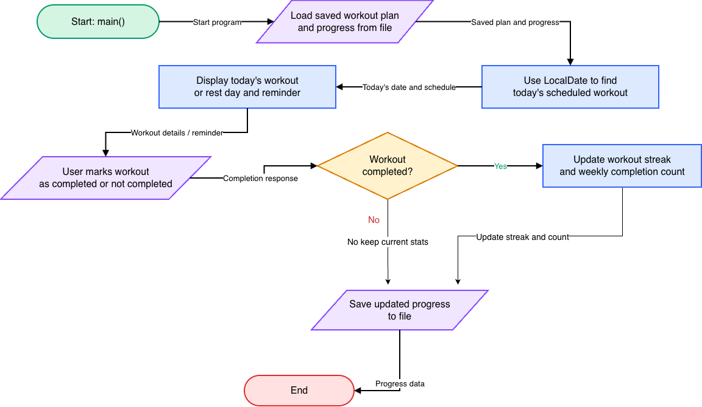

# Workout tracker

A Java application that helps users stay consistent with their exercise routines by organizing weekly workouts and tracking progress.

## The Problem

Maintaining a consistent exercise routine can be difficult without a clear schedule. People may forget planned workouts, lose track of completed sessions, or struggle to stay motivated over time. I built Workout tracker to provide a simple way to organize workouts, track consistency, and encourage users to maintain an active routine.

## How it works 

Workout Tracker allows users to create a personalized 7-day workout schedule and view the workout planned for the current day. Users can mark workouts as completed, track their workout streaks, and view their weekly statistics. The application saves workout schedules and sends reminders to the users daily for the workout that they must complete. 

## Tech Stack

Language: Java

Libraries: Java standard libraries, including LocalDate and ArrayList

External tools: IntelliJ IDEA, Git, and GitHub

Data Storage: Local CSV files using Java File I/O

## Setup 

Clone the repository:

git clone https://github.com/Triambak1109/workout-tracker.git

Navigate into the project directory:

cd workout-tracker

Open the project in IntelliJ IDEA.

Make sure a compatible Java JDK is installed.

Run Main.java to start the application.

## Usage

To start Workout Tracker, navigate to the project directory and run:

javac src/Main.java

java -cp src Main

Once launched, the user will be able to track workouts and get reminders to stay consistent.
The application uses a minimalistic interface that allows users to create plans and follow them easier.

## Roadmap

Features planned for future development:
- Track workout duration.
- Display monthly workout summaries.
- Edit existing workout schedules.
- Implement desktop notifications.
- Display muscle groups targeted by each workout.

## Author

Triambak Srinivasan, https://github.com/Triambak1109

